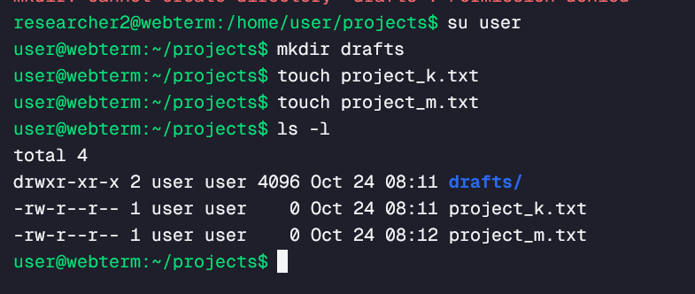
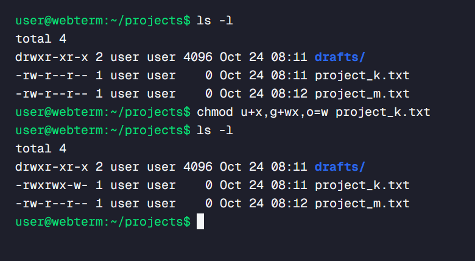
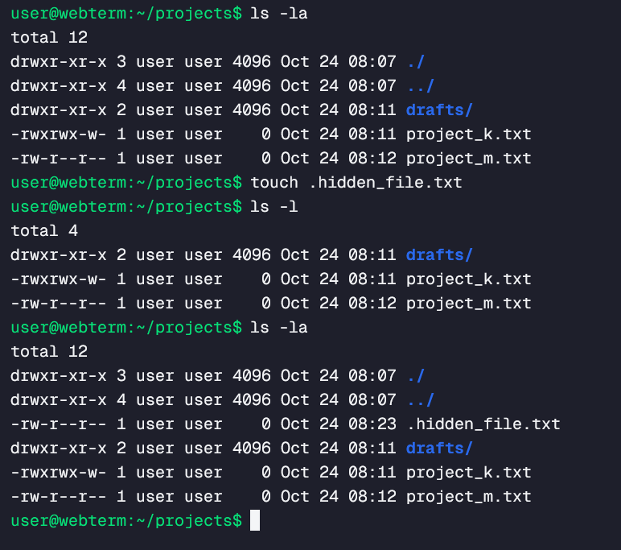
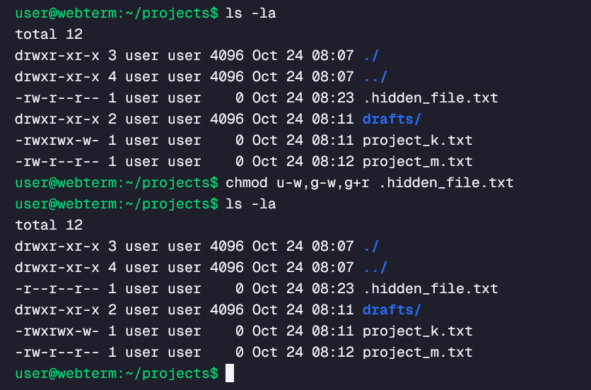
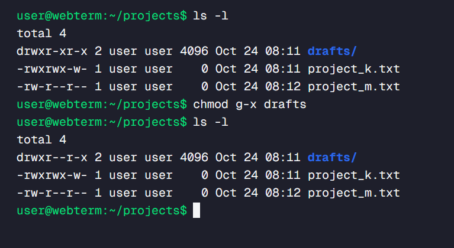
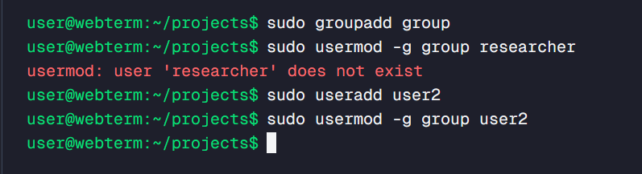

## File permissions in Linux

### Project description
I am a security professional at a large organization. I mainly work with their research team. Part of my job is to ensure users on this team are authorized with the appropriate permissions. This helps keep the system secure.

My task is to examine existing permissions on the file system. I’ll need to determine if the permissions match the authorization that should be given. If they do not match, I’ll need to modify the permissions to authorize the appropriate users and remove any unauthorized access.

### Task: Check file and directory details
The task is to check current file permissions document to determine the current permissions.

Performed steps:

* Added directory drafts in projects folder:
```shell
mkdir drafts.
```

* Added files project_k.txt and project_m.txt into projects directory.
```shell
Touch project_k.txt
```

* Listed files with permission information:
```shell
ls -l
```

### Task: Describe the permissions string



| Permission string for drafts folder                                                 |
|-------------------------------------------------------------------------------------|
| d – directory                                                                       |
| rwx – read, write, execute permissions for user; user is the owner of the directory |
| r-x - read and execute permissions for group; user is the owner of the directory    |
| r-x – read and execute permissions for others; user is the owner of the directory   |

| Permission string for project_k.txt and project_m.txt               |
|---------------------------------------------------------------------|
| - not directory                                                     |
| rw- - read, write permissions for user, user is the owner of the directory |
| r-- - read permission for group, user is the owner of the directory |
| r-- - read permission for other, user is the owner of the directory |
 
### Task: Change file permissions
The task is to change file permission.


* Changing permission for project_k.txt using
chmod u+x,g+wx,o=w project.txt

That means: adding executable for user, adding write and executable for group and other has only write permission to file “project.txt”

### Task: Change file permissions on a hidden file
The task was to change file permission on a hidden file.


In my testing environment, there were no hidden files. I needed to add one to the system: 
```shell
touch .hidden_file.txt
```
To check permission for all files and directories (including hidden files), I used command: 
```shell
Ls -la
```
Output:


To change hidden files permissions, I used command:
```shell
chmod u-w,g-w,g+r .hidden_file.txt
```
That means:
* for user – removed write permission, 
* for group: removed write and add read permissions
on a file '.hidden_file.txt'

### Task: Change directory permissions
The task was to chamge directpry permissions.


To remove executable permission from group for draft directory I used:
```shell
chmod g-x drafts
```
___
### Changing ownership of a file



* Adding a new user group:
```shell
sudo groupadd group
```

* Adding new user:
```shell
sudo useradd user2
```

* Adding user2 to group group
```shell
sudo usermod -g group user2
```

To change ownership of project_m.txt to group I used command:
```shell
sudo chown :group project_m.txt.
```

### Summary
The following exercise proves I have practical experience in using basic Linux Bash shell commands to 
* examine file and directory permissions,
* change permissions on files, and
* change permissions on directories.

Used tool for Linux command training:
https://webterm.app/en/free-play