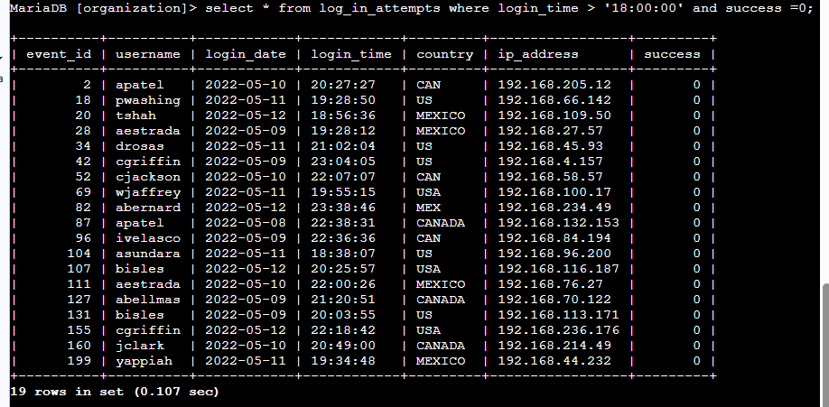
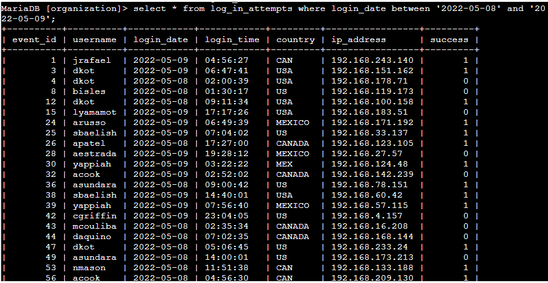
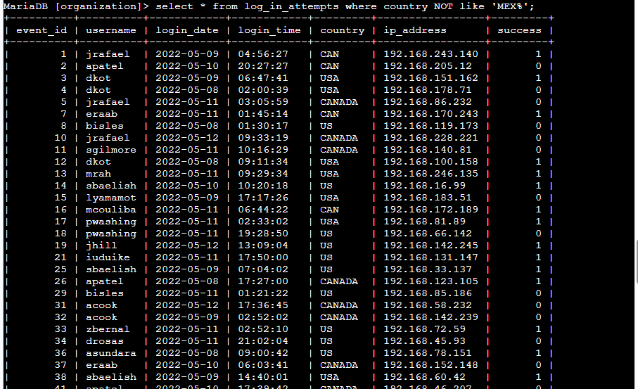
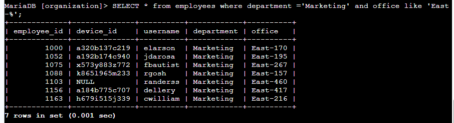
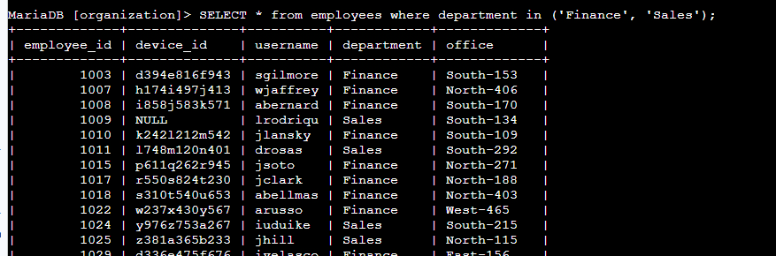
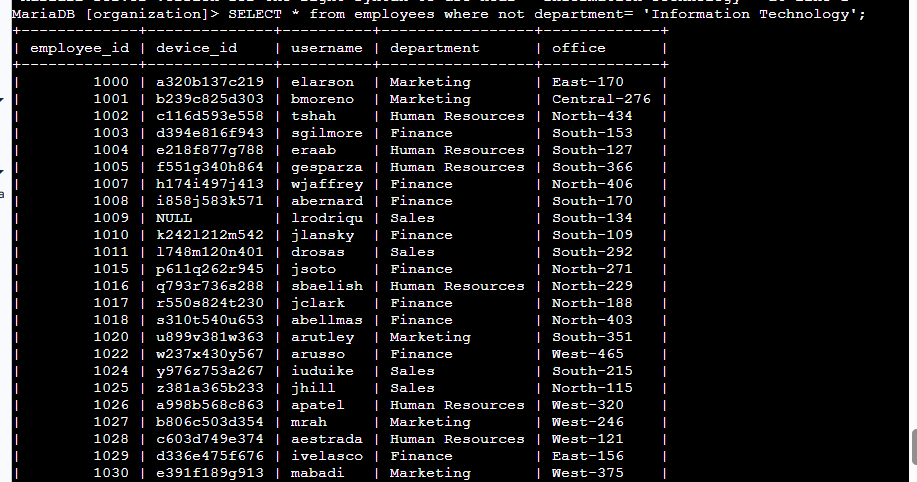

## Apply filters to SQL queries

### Project description
I am a security professional at a large organization. Part of my job is to investigate security issues to help keep the system secure. I recently discovered some potential security issues that involve login attempts and employee machines.

### Task: Retrieve after hours failed login attempts
Your team is investigating failed login attempts that were made after business hours. I want to retrieve this information from the login activity. I’ll identify all unsuccessful attempts after 18:00.

The login_time column in the log_in_attempts table contains information on when login attempts were made. Office hours end at '18:00'.

To retrieve failed login attempts after 18:00 I used where condition with > operator for login time and AND operator for adding next condition.

``` 
SELECT *
FROM log_in_attempts
WHERE login_time > '18:00:00' AND success = 0;
```

The results of running the query:


### Task: Retrieve login attempts on specific dates
My team is investigating a suspicious event that occurred on '2022-05-09'. I want to retrieve all login attempts that occurred on this day and the day before ('2022-05-08').

To retrieve login attempt that occurred on 8 and 9 th May I used BETWEEN operator for filtering login date.
```shell
SELECT *
FROM log_in_attempts
WHERE login_date between '2022-05-08’and '2022-05-09';
```

The results of running the query:


### Task: Retrieve login attempts outside of Mexico
Now, your team is investigating logins that did not originate in Mexico, and you need to find this information. Note that the country field includes entries with 'MEX' and 'MEXICO'. You should use the NOT and LIKE operators and the matching pattern 'MEX%'.

For retrieve login attempts outside of Mexico, I used operator LIKE with wildchard, to be able to find string that starts with ‘MEX’. Additionaly, I used NOT because I look for loging attempts outside Mexico.
```shell
select * from log_in_attempts where country not like ‘MEX%’;
```
The results of running the query:


### Task: Retrieve employees in Marketing
My team is updating employee machines, and I need to obtain the information about employees in the 'Marketing' department who are located in all offices in the East building (such as 'East-170' or 'East-320').

To retrieve employees in marketing department, I used condition using '=' sign. To retrieve employees that are locates in East building, I used like operator for office column filtering.

```shell
SELECT * from employees where department ='Marketing' and office like 'East-%';
```
The results of running the query:


### Task: Retrieve employees in Finance or Sales
Now, my team needs to perform a different update to the computers of all employees in the Finance or the Sales department, and I need to locate information on these employees.

To find employees for departments Finance or Sales, I used IN operator.

```shell
Select * from employees where department in (‘Fifnace’,’Sales’);
```

The results of running the query:


### Task: Retrieve all employees not in IT
My team needs to make one more update. This update was already made to employee computers in the Information Technology department. The team needs information about employees who are not in that department.

To find employees outside the IT department, I used NOT operator for filtering on department column.

```shell
Select * from employee where not department = ‘Information Technology’
```
The result of running the query:


### Summary

I applied filters to SQL queries to get specific information on login attempts and employee machines. I used the AND, OR, IN, and NOT operators to filter for the specific information needed for each task. I also used LIKE and the percentage sign (%) wildcard to filter for patterns.